  <h1>Hi 👋, I'm Yanzhou Chen</h1>
  
<strong>I build JavaScript userscripts to automate repetitive tasks in the browser.</strong>

## About Me

My public projects cover two browser workflows: matching physics lab questions and sending scheduled messages on Douyin. I work with the browser DOM, check page state before taking action, and handle failures so a retry doesn't repeat a completed action.

## Featured Projects

### [Physics Lab Pre-exam](https://github.com/c2451134117-cyber/physics-lab-preexam)

I maintain separate Tampermonkey scripts for two versions of a physics lab pre-exam platform. The newer script matches question text and the full set of answer choices, even when questions and choices appear in a different order. It records a lock in IndexedDB before submitting to prevent duplicate submissions when the network response is inconclusive.

`JavaScript` · `Tampermonkey` · `IndexedDB` · [Offline tests for matching and early exits](https://github.com/c2451134117-cyber/physics-lab-preexam/blob/b5eddfb2e261daa26a588aa3cd95b33c5a36a20a/tests/szu.test.cjs)

### [Douyin Fire Helper](https://github.com/c2451134117-cyber/douyin-fire-helper)

I maintain a version of [ScriptCat-Douyin-Fire-Helper](https://github.com/dr-190/ScriptCat-Douyin-Fire-Helper) with configurable messages for each day of the week. The script checks the chat title before sending. When a batch is retried, it skips chats where the message already went through that day.

`JavaScript` · `Tampermonkey / ScriptCat` · `Browser DOM`

## GitHub Activity

  
  

  <picture>
    <source media="(prefers-color-scheme: dark)" srcset="assets/snake-dark.svg">
    <source media="(prefers-color-scheme: light)" srcset="assets/snake-light.svg">
    
  </picture>

## Technologies and Interests

  

`JavaScript` `HTML` `CSS` `Node.js` `GitHub` `Tampermonkey` `ScriptCat` `DOM` `IndexedDB`

I'm interested in how browser scripts can identify the right target as a page changes, confirm whether an action succeeded, and reproduce shuffled inputs and failures in offline tests.

## Contact

[GitHub @c2451134117-cyber](https://github.com/c2451134117-cyber) · [Physics Lab Issues](https://github.com/c2451134117-cyber/physics-lab-preexam/issues) · [Douyin Helper Issues](https://github.com/c2451134117-cyber/douyin-fire-helper/issues)
